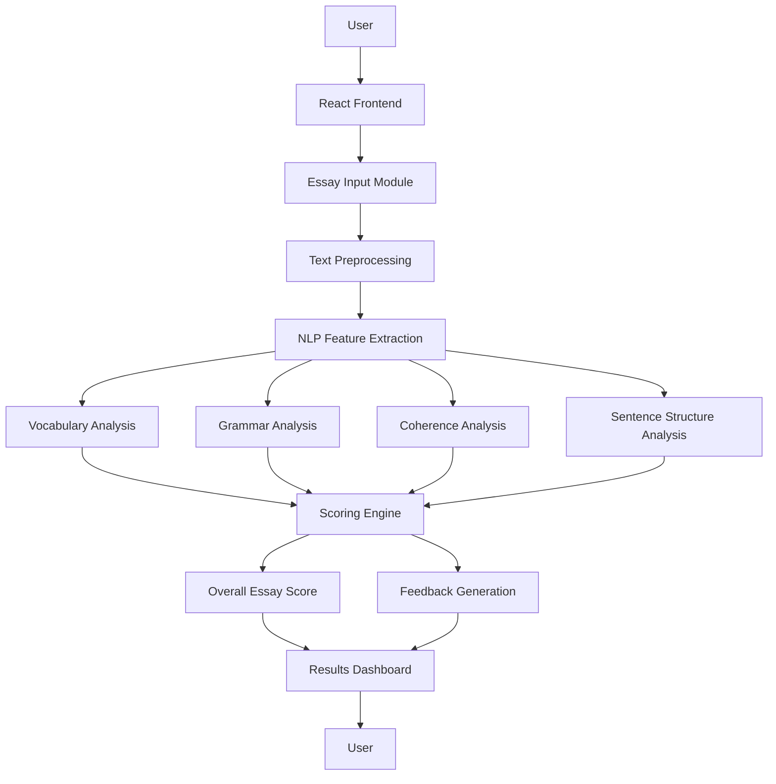
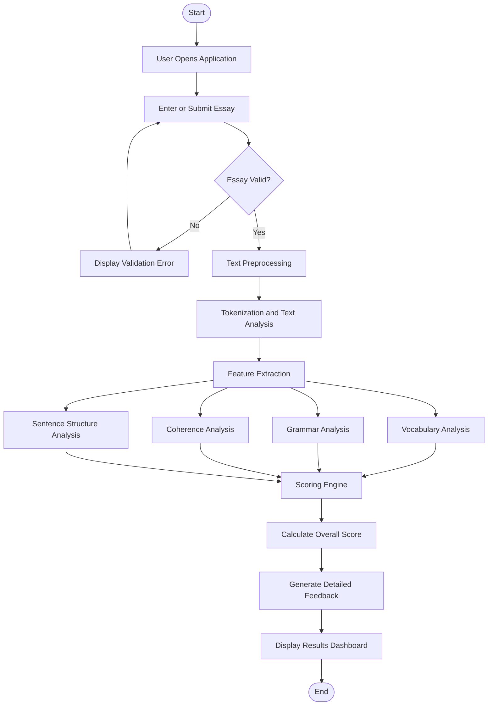

# 📝 Word Wizard Grader – Automatic Essay Scoring System

An AI-powered Automatic Essay Scoring System that evaluates essays using Natural Language Processing (NLP) and machine learning techniques. It analyzes written content, generates scores, and provides detailed feedback to help students improve their writing skills.

## 🔗 Project Links

- **GitHub:** [RahulRathod90](https://github.com/RahulRathod90)
- **Repository:** [Word Wizard Grader](https://github.com/RahulRathod90/word-wizard-grader)
- **Live Demo:** `http://localhost:8080` (Local development only)

---

## ✨ Features

- **Automated Essay Scoring:** Evaluates essays based on vocabulary, grammar, structure, and coherence.
- **Instant Feedback:** Provides suggestions to improve writing quality.
- **Detailed Score Analysis:** Displays individual evaluation metrics and overall performance.
- **Vocabulary Analysis:** Analyzes vocabulary richness and word usage.
- **Coherence Analysis:** Examines logical flow and consistency between sentences.
- **Modern User Interface:** Clean and responsive interface for a better user experience.

---

## 🛠️ Tech Stack

| Technology | Purpose |
|---|---|
| React | Frontend development |
| TypeScript | Type-safe programming |
| Vite | Development and build tool |
| Tailwind CSS | Styling |
| shadcn/ui | UI components |
| NLP | Text analysis and processing |
| ASAP Dataset | Essay scoring research dataset |
| Supabase | Backend and database services (if configured) |

---

## 🏗️ System Architecture

The Word Wizard Grader follows a modular architecture that separates the user interface, essay processing, NLP analysis, scoring, and feedback generation.



### Architecture Components

| Component | Responsibility |
|---|---|
| React Frontend | Provides the user interface for essay submission and results |
| Essay Input Module | Accepts essay text from users |
| Text Preprocessing | Cleans and prepares text for analysis |
| NLP Feature Extraction | Extracts relevant linguistic features |
| Vocabulary Analysis | Measures vocabulary richness and word usage |
| Grammar Analysis | Evaluates grammatical patterns |
| Coherence Analysis | Examines logical flow and consistency |
| Scoring Engine | Combines evaluation results into an overall score |
| Feedback Generation | Produces suggestions for writing improvement |
| Results Dashboard | Displays scores, analysis, and feedback |

---

## 🔄 System Workflow

The system processes an essay through the following stages:



### Workflow Explanation

1. **User Input:** The user enters or submits an essay.
2. **Input Validation:** The system checks whether the submitted essay contains valid text.
3. **Text Preprocessing:** The essay is cleaned and prepared for NLP processing.
4. **Tokenization:** The text is divided into words and sentences for analysis.
5. **Feature Extraction:** Important linguistic features are extracted.
6. **Vocabulary Analysis:** Vocabulary richness and word usage are evaluated.
7. **Grammar Analysis:** Grammatical patterns are examined.
8. **Coherence Analysis:** Sentence relationships and logical flow are analyzed.
9. **Scoring:** The scoring engine combines the evaluation results.
10. **Feedback Generation:** Actionable suggestions are generated.
11. **Result Display:** The final score and detailed feedback are presented to the user.

---

## 📂 Project Structure

```text
word-wizard-grader/
│
├── public/                 # Static assets
├── src/
│   ├── components/         # Reusable UI components
│   ├── pages/              # Application pages
│   ├── hooks/              # Custom React hooks
│   ├── lib/                # Utility functions
│   ├── App.tsx             # Main application
│   ├── main.tsx            # Application entry point
│   └── index.css           # Global styles
│
├── package.json
├── package-lock.json
├── vite.config.ts
├── tailwind.config.ts
├── tsconfig.json
└── README.md
```

*Note: Update this illustrative structure to match your actual repository.*

---

## 🚀 Getting Started

### Prerequisites

- [Node.js](https://nodejs.org/) (v18 or later)
- npm
- Git

### 1. Clone the Repository

```bash
git clone https://github.com/RahulRathod90/word-wizard-grader.git
```

### 2. Navigate to the Project Directory

```bash
cd word-wizard-grader
```

### 3. Install Dependencies

```bash
npm install
```

### 4. Start the Development Server

```bash
npm run dev
```

### 5. Open in Browser

```text
http://localhost:8080
```

---

## 🎯 Project Objectives

- Automate the essay evaluation process.
- Reduce manual evaluation effort and time.
- Analyze vocabulary richness and writing coherence.
- Provide consistent and useful feedback.
- Help students improve their academic writing skills.

---

## 🔮 Future Enhancements

- Integrate a trained machine learning essay-scoring model.
- Improve grammar and spelling detection.
- Add advanced NLP-based semantic analysis.
- Implement personalized writing recommendations.
- Support multiple essay types and evaluation criteria.
- Add student progress tracking and performance analytics.

---

## 👨‍💻 Author

**Rahul Rathod**

AI & Machine Learning Engineering Student

- GitHub: [@RahulRathod90](https://github.com/RahulRathod90)

---

## 📄 License

This project is developed for educational and academic purposes.

---

⭐ If you find this project interesting, consider giving the repository a star!
